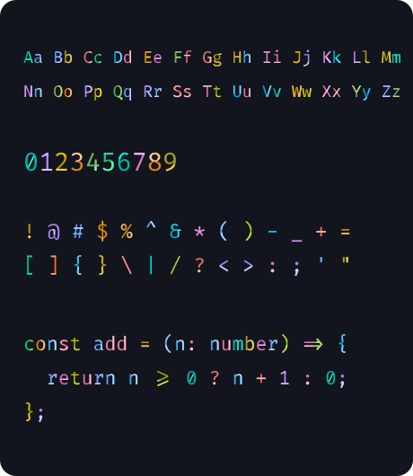
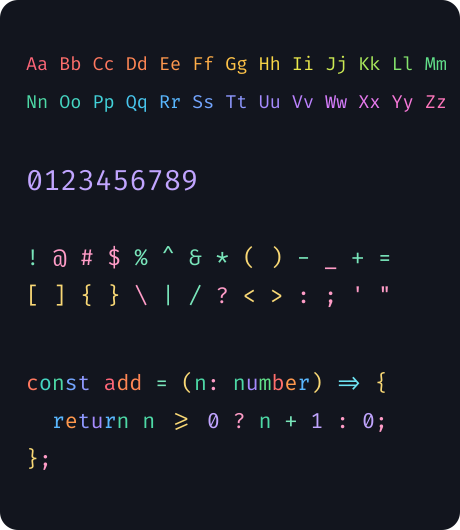
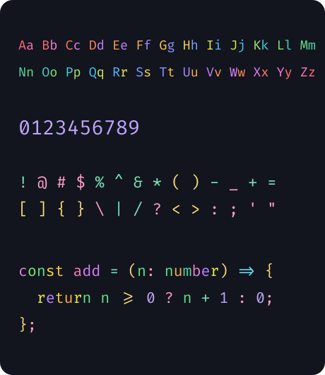
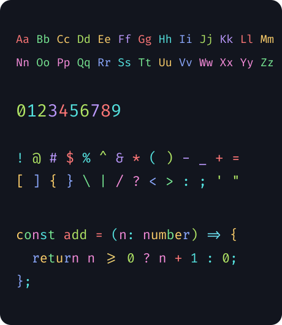

# PrismCode

PrismCode is a family of monospaced color fonts based on Fira Code 6.2 Regular. The original PrismCode Regular uses OpenType COLRv1 to give the left leg, right leg, and crossbar of `A` their own colors. [Three seeded stroke themes](#seeded-stroke-themes) use the same outlines and masks. [Four solid-color variants](#solid-color-variants) assign a fixed color to each mapped glyph.

**Sunset · default**


**Aurora**


**Neon**


[Download TTF](fonts/PrismCode-Regular.ttf) · [Download WOFF2](fonts/PrismCode-Regular.woff2) · [Browser demo](demo/index.html)

[PrismCode showcase](https://princefishthrower.github.io/PrismCode/) · [Theme gallery](https://princefishthrower.github.io/PrismCode/themes/)


## Use the stroke palettes on the web

Copy the WOFF2 to your site and update the URL to match. Sunset is palette `0` and is used by default. To use Neon in this example, change `base-palette` to `2`.

```css
@font-face {
  font-family: PrismCode;
  src: url("/fonts/PrismCode-Regular.woff2") format("woff2");
  font-style: normal;
  font-weight: 400;
  font-display: swap;
}

@font-palette-values --aurora {
  font-family: PrismCode;
  base-palette: 1;
}

code {
  font-family: PrismCode, ui-monospace, monospace;
  font-variant-ligatures: contextual;
}

code.aurora {
  font-palette: --aurora;
}
```

```html
<code>const add = (n: number) =&gt; n + 1;</code>
<code class="aurora">const add = (n: number) =&gt; n + 1;</code>
```

Use `override-colors` to replace individual palette entries. Here all three entries are overridden.

```css
@font-palette-values --custom {
  font-family: PrismCode;
  base-palette: 0;
  override-colors: 0 #F472B6, 1 #60A5FA, 2 #FDE68A;
}

code.custom {
  font-palette: --custom;
}
```

```html
<code class="custom">const add = (n: number) =&gt; n + 1;</code>
```

Open [`demo/index.html`](demo/index.html) locally to compare the stroke palettes, seeded stroke themes, and solid-color variants at 12, 14, and 16 px.

## Seeded stroke themes

Each theme is a separate COLRv1 font family. The seed and glyph name determine the colors at build time, so repeated glyphs use the same colors. Unmapped glyphs use the current text color. Colors are tuned for the dark preview background.

The bundled seed is `20261113`. To rebuild the three themes and their previews with another seed, set `PRISMCODE_SEED` to an integer. Use the same seed when running the tests against those files.

```sh
PRISMCODE_SEED=42 npm run build
PRISMCODE_SEED=42 npm test
```

To change the hue step, edit `defaultHueRotation` in [`src/stroke-colors.ts`](src/stroke-colors.ts).

Chrome and Firefox rendered these themes in color at 12, 14, and 16 px. Playwright WebKit rendered the monochrome outlines.

### True Shuffle

Each stroke draws its own hue, lightness, and chroma from a vivid range.


[PrismCode-TrueShuffle.ttf](fonts/PrismCode-TrueShuffle.ttf) · [PrismCode-TrueShuffle.woff2](fonts/PrismCode-TrueShuffle.woff2)

```css
@font-face {
  font-family: "PrismCode True Shuffle";
  src: url("./fonts/PrismCode-TrueShuffle.woff2") format("woff2");
}

code.true-shuffle {
  font-family: "PrismCode True Shuffle", monospace;
}
```

### Shuffle Hue Rotation

Each glyph starts with a seeded base color. Successive strokes rotate its OKLCH hue by 45°, keeping lightness constant and retaining as much chroma as sRGB allows.


[PrismCode-ShuffleHueRotation.ttf](fonts/PrismCode-ShuffleHueRotation.ttf) · [PrismCode-ShuffleHueRotation.woff2](fonts/PrismCode-ShuffleHueRotation.woff2)

```css
@font-face {
  font-family: "PrismCode Shuffle Hue Rotation";
  src: url("./fonts/PrismCode-ShuffleHueRotation.woff2") format("woff2");
}

code.shuffle-hue-rotation {
  font-family: "PrismCode Shuffle Hue Rotation", monospace;
}
```

### Shades

Each glyph keeps one seeded hue. Its strokes run from darker to lighter in OKLCH.



[PrismCode-Shades.ttf](fonts/PrismCode-Shades.ttf) · [PrismCode-Shades.woff2](fonts/PrismCode-Shades.woff2)

```css
@font-face {
  font-family: "PrismCode Shades";
  src: url("./fonts/PrismCode-Shades.woff2") format("woff2");
}

code.shades {
  font-family: "PrismCode Shades", monospace;
}
```

## Solid-color variants

Each family has one fixed COLRv0 palette. Every visible printable ASCII glyph and the 20 programming sequences listed under Stroke palette coverage have assigned colors. Other glyphs use the current text color.

Spectrum and Spectrum Mirror share supplemental colors for digits, brackets, operators, and other punctuation. Both keyboard families repeat colors every four keys within a row and use disjoint sets on neighboring rows. All four families use the same explicit operator colors for programming ligatures. [US keyboard layouts in XKB](https://github.com/xkbcommon/libxkbcommon/blob/master/test/data/symbols/us)

Each family is loaded directly with its own `font-family`.

All four WOFF2 families rendered in color at 12, 14, and 16 px in Chrome 157, Firefox 159, and Playwright WebKit 27.2 on macOS.

### Spectrum

A fixed 26-color rainbow follows A–Z. Lowercase letters match uppercase.



[PrismCode-Spectrum.ttf](fonts/PrismCode-Spectrum.ttf) · [PrismCode-Spectrum.woff2](fonts/PrismCode-Spectrum.woff2)

```css
@font-face {
  font-family: "PrismCode Spectrum";
  src: url("./fonts/PrismCode-Spectrum.woff2") format("woff2");
}

code.spectrum {
  font-family: "PrismCode Spectrum", monospace;
}
```

### Spectrum Mirror

Uppercase follows Spectrum. Lowercase uses the rainbow in reverse, so a matches Z and z matches A.



[PrismCode-SpectrumMirror.ttf](fonts/PrismCode-SpectrumMirror.ttf) · [PrismCode-SpectrumMirror.woff2](fonts/PrismCode-SpectrumMirror.woff2)

```css
@font-face {
  font-family: "PrismCode Spectrum Mirror";
  src: url("./fonts/PrismCode-SpectrumMirror.woff2") format("woff2");
}

code.spectrum-mirror {
  font-family: "PrismCode Spectrum Mirror", monospace;
}
```

### Dvorak

Colors follow physical key positions on the standard US Dvorak layout. Case and shifted symbols share the color of their key.


[PrismCode-Dvorak.ttf](fonts/PrismCode-Dvorak.ttf) · [PrismCode-Dvorak.woff2](fonts/PrismCode-Dvorak.woff2)

```css
@font-face {
  font-family: "PrismCode Dvorak";
  src: url("./fonts/PrismCode-Dvorak.woff2") format("woff2");
}

code.dvorak {
  font-family: "PrismCode Dvorak", monospace;
}
```

### Qwerty

Colors follow physical key positions on the standard US QWERTY layout, using the same position colors as Dvorak. Case and shifted symbols share the color of their key.



[PrismCode-Qwerty.ttf](fonts/PrismCode-Qwerty.ttf) · [PrismCode-Qwerty.woff2](fonts/PrismCode-Qwerty.woff2)

```css
@font-face {
  font-family: "PrismCode Qwerty";
  src: url("./fonts/PrismCode-Qwerty.woff2") format("woff2");
}

code.qwerty {
  font-family: "PrismCode Qwerty", monospace;
}
```

## Stroke palette coverage

- Regular weight only. All 94 visible printable ASCII characters have color definitions. Single-component marks such as `.` and `_` use one solid color. Space retains its original advance.
- Color also covers the visible Fira Code 6.2 glyphs shaped for `=>`, `->`, `<-`, `==`, `===`, `!=`, `!==`, `<=`, `>=`, `&&`, `||`, `??`, `...`, `::`, `++`, `--`, `//`, `/*`, `*/`, and `**`. Contextual and stylistic alternates outside that set can appear in monochrome.
- Other original Fira Code glyphs, such as `λ` and `é`, inherit the text color. Applications without COLRv1 support can render the original monochrome outlines. Ligature shaping and palette selection depend on the application.

The WOFF2 demo rendered all three palettes and its programming ligatures at 12, 14, and 16 px in Chrome 157 and Firefox 159 on macOS. Playwright WebKit 27.2 loaded the same font and rendered it in monochrome. The SVG previews use embedded paths and display their colors independently of the browser's font support. [Chromium COLRv1 documentation](https://developer.chrome.com/blog/colrv1-fonts) · [Firefox palette support](https://developer.mozilla.org/en-US/docs/Mozilla/Firefox/Releases/107)

## Build and test

Requires Node.js 22.18 or later.

```sh
npm ci
npm run build
npm test
```

The build uses the static Regular TTF from `firacode@6.2.0` and verifies its SHA-256. Font Flux JS encodes the COLR and CPAL tables and exports both formats. The color paints clip hand-authored solid fills to the original glyph outlines. The generator appends unencoded mask glyphs and keeps the original outline records, glyph IDs, Unicode mappings, and layout tables. HarfBuzz shapes the preview text so the SVGs include the same ligature outlines used by the font.

Edit [`src/strokes.ts`](src/strokes.ts) to adjust a glyph. Each entry specifies a base palette index and optional polygon masks in font units. Later masks paint over earlier fills. The base glyph clips all fills to its silhouette.

Edit [`src/variants.ts`](src/variants.ts) to change the fixed rainbow, keyboard, or ligature colors. The solid-color families use a single COLRv0 layer that references the original glyph directly.

## Attribution and licensing

The fonts and glyph outlines derive from [Fira Code 6.2](https://github.com/tonsky/FiraCode/releases/tag/6.2) by the Fira Code Project Authors. They are distributed under the [SIL Open Font License 1.1](OFL.txt). The fonts retain upstream authorship and license notices and identify the modified family as PrismCode.

Copyright © 2026 Full Stack Craft LLC for the PrismCode modifications and original code. The independently authored code is [MIT-licensed](LICENSE). The generator imports [Font Flux JS 2.9.1](https://www.npmjs.com/package/font-flux-js/v/2.9.1), which is GPL-3.0-only. Distributing the combined generator with Font Flux JS calls for GPL-3.0 terms and corresponding source for the combination. The MIT grant remains available for the independently authored code. The generated TTF and WOFF2 contain Fira Code-derived font data and PrismCode paints and are distributed under the OFL. [GNU GPL FAQ](https://www.gnu.org/licenses/gpl-faq.en.html#IfLibraryIsGPL)
