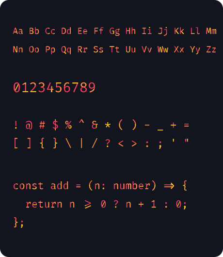
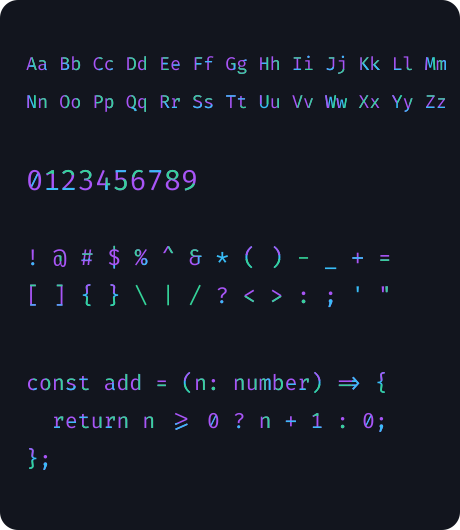
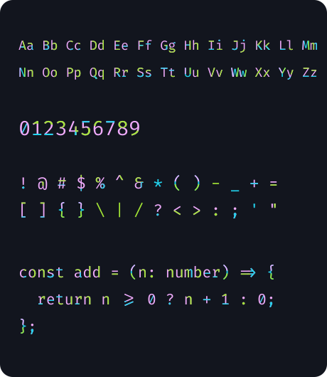
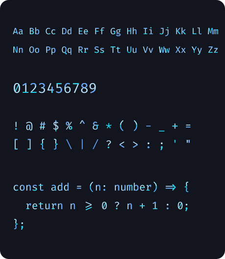
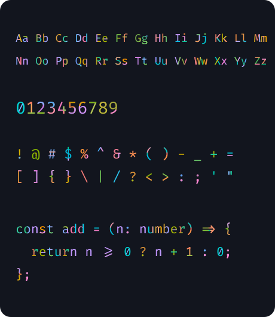
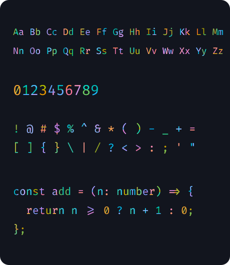
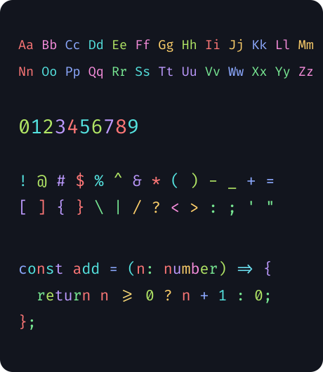

# PrismCode

PrismCode is a family of monospaced color fonts based on Fira Code 6.2 Regular.

View all the themes on [the PrismCode website](https://princefishthrower.github.io/PrismCode/)

## Themes

### Sunset

Warm stroke palette.



### Aurora

Cooler palette tuned for dark backgrounds.



### Neon

High-energy palette with bright contrast.



### Ice

Pale blue, sky blue, and cyan across the same strokes as Sunset.



[Download TTF](fonts/PrismCode-Regular.ttf) · [Download WOFF2](fonts/PrismCode-Regular.woff2) · [All fonts as ZIP files](https://github.com/princefishthrower/PrismCode/releases/latest)

### True Shuffle

Each stroke draws its own hue, lightness, and chroma from a vivid range.



### Shuffle Hue Rotation

Each glyph starts with a seeded base color. Successive strokes rotate its OKLCH hue by 45°, keeping lightness constant and retaining as much chroma as sRGB allows.



### Shades

Each glyph keeps one seeded hue. Its strokes run from darker to lighter in OKLCH.


### Spectrum

A fixed 26-color rainbow follows A–Z. Lowercase letters match uppercase.


### Spectrum Mirror

Uppercase follows Spectrum. Lowercase uses the rainbow in reverse, so a matches Z and z matches A.


### Dvorak

Colors follow physical key positions on the standard US Dvorak layout. Case and shifted symbols share the color of their key.



### Qwerty

Colors follow physical key positions on the standard US QWERTY layout, using the same position colors as Dvorak. Case and shifted symbols share the color of their key.


## Using PrismCode

Sunset is the default palette at index `0`. Aurora is `1`, Neon is `2`, and Ice is `3`.

The markup:

```html
<code>const add = (n: number) =&gt; n + 1;</code>
<code class="aurora">const add = (n: number) =&gt; n + 1;</code>
```

Use `override-colors` to replace individual palette entries. Here all three entries are overridden.

```html
<code class="custom">const add = (n: number) =&gt; n + 1;</code>
```

And corresponding CSS:

```css
@font-face {
  font-family: "PrismCode";
  src: url("/fonts/PrismCode-Regular.woff2") format("woff2"); /* Change this path to your actual font file location. */
  font-style: normal;
  font-weight: 400;
}

@font-palette-values --prismcode-theme {
  font-family: "PrismCode";
  base-palette: 1; /* Use 0 for Sunset, 1 for Aurora, 2 for Neon, or 3 for Ice. */
}

code {
  font-family: "PrismCode", ui-monospace, monospace;
  font-palette: --prismcode-theme;
}
```

```css
@font-palette-values --prismcode-custom {
  font-family: "PrismCode";
  base-palette: 0;
  override-colors: 0 #F472B6, 1 #60A5FA, 2 #FDE68A; /* You can change these color values to define your own palette overrides. */
}

code.custom {
  font-family: "PrismCode", ui-monospace, monospace;
  font-palette: --prismcode-custom;
}
```

## Seeded Stroke Themes

Each theme is a separate COLRv1 font family. The color determination process in COLRv1 is inherently random, so seed and glyph name determine the colors at build time. For all themes, the colors have been tuned for a dark background.

The currently bundled fonts in 0.1.0 use seed `20261113` (the date when I first released PrismCode). To rebuild the three themes and their previews with another seed, set `PRISMCODE_SEED` to any other integer. Use the same seed when running the tests against those files.

```sh
PRISMCODE_SEED=42 npm run build
PRISMCODE_SEED=42 npm test
```

## Solid-Color Variants

Each family has one fixed COLRv0 palette. Every visible printable ASCII glyph and the 20 programming sequences listed under Stroke palette coverage have assigned colors. Other glyphs use the current text color.

Spectrum and Spectrum Mirror share supplemental colors for digits, brackets, operators, and other punctuation. Both keyboard families repeat colors every four keys within a row and use disjoint sets on neighboring rows. All four families use the same explicit operator colors for programming ligatures. [US keyboard layouts in XKB](https://github.com/xkbcommon/libxkbcommon/blob/master/test/data/symbols/us)

## Current Coverage

- Regular weight only. All 94 visible printable ASCII characters have color definitions. Single-component marks such as `.` and `_` use one solid color. Space retains its original advance.
- Color also covers the visible Fira Code 6.2 glyphs shaped for `=>`, `->`, `<-`, `==`, `===`, `!=`, `!==`, `<=`, `>=`, `&&`, `||`, `??`, `...`, `::`, `++`, `--`, `//`, `/*`, `*/`, and `**`. Contextual and stylistic alternates outside that set can appear in monochrome.
- Other original Fira Code glyphs, such as `λ` and `é`, inherit the text color. Applications without COLRv1 support can render the original monochrome outlines. Ligature shaping and palette selection depend on the application.

PrismCode Regular rendered its stroke palettes and its programming ligatures at 12, 14, and 16 px in Chrome 157 and Firefox 159 on macOS. Playwright WebKit 27.2 loaded the same font and rendered it in monochrome. The SVG previews use embedded paths and display their colors independently of the browser's font support. [Chromium COLRv1 documentation](https://developer.chrome.com/blog/colrv1-fonts) · [Firefox palette support](https://developer.mozilla.org/en-US/docs/Mozilla/Firefox/Releases/107)

## Build and Test

Requires Node.js 22.18 or later.

```sh
npm ci
npm run build
npm test
```

The build uses the static Regular TTF from `firacode@6.2.0` and verifies its SHA-256. Font Flux JS encodes the COLR and CPAL tables and exports both formats. The color paints clip hand-authored solid fills to the original glyph outlines. The generator appends unencoded mask glyphs and keeps the original outline records, glyph IDs, Unicode mappings, and layout tables. HarfBuzz shapes the preview text so the SVGs include the same ligature outlines used by the font.

Edit [`src/strokes.ts`](src/strokes.ts) to adjust a glyph. Each entry specifies a base palette index and optional polygon masks in font units. Later masks paint over earlier fills. The base glyph clips all fills to its silhouette.

Edit [`src/variants.ts`](src/variants.ts) to change the fixed rainbow, keyboard, or ligature colors. The solid-color families use a single COLRv0 layer that references the original glyph directly.

### Release

Releases are tag based. [The workflow](.github/workflows/release.yml) builds every family from source, runs the tests, then attaches `PrismCode-TTF.zip` and `PrismCode-WOFF2.zip` to a GitHub release. Each zip holds the freshly built fonts plus the OFL.

The build is reproducible, so a clean build of a commit matches the `fonts/` and `previews/` committed with it byte for byte. Those directories stay in the repository for the download links and images above. The release and [Pages](.github/workflows/pages.yml) workflows both rebuild them and stop if anything differs, so commit the output of `npm run build` along with any change to `src/`. The workflows never set `PRISMCODE_SEED`. To ship a different seed, change `defaultStrokeSeed` in [`src/stroke-colors.ts`](src/stroke-colors.ts).

## Attribution and Licensing

The fonts and glyph outlines derive from [Fira Code 6.2](https://github.com/tonsky/FiraCode/releases/tag/6.2) by the Fira Code Project Authors. They are distributed under the [SIL Open Font License 1.1](OFL.txt). The fonts retain upstream authorship and license notices and identify the modified family as PrismCode.

Copyright © 2026 Full Stack Craft LLC for the PrismCode modifications and original code. The independently authored code is [MIT-licensed](LICENSE). The generator imports [Font Flux JS 2.9.1](https://www.npmjs.com/package/font-flux-js/v/2.9.1), which is GPL-3.0-only. Distributing the combined generator with Font Flux JS calls for GPL-3.0 terms and corresponding source for the combination. The MIT grant remains available for the independently authored code. The generated TTF and WOFF2 contain Fira Code-derived font data and PrismCode paints and are distributed under the OFL. [GNU GPL FAQ](https://www.gnu.org/licenses/gpl-faq.en.html#IfLibraryIsGPL)

## Thanks

- The Fira Code Project Authors for the glyphs, monospace metrics, and programming ligatures that PrismCode builds on. [Fira Code](https://github.com/tonsky/FiraCode)
- The Font Flux JS contributors for the tools that write the color tables and export the TTF and WOFF2 files. [Font Flux JS](https://github.com/WithYerTeeth/font-flux-js)
- The HarfBuzz contributors for shaping preview text and checking that the generated fonts preserve Fira Code's ligatures. [HarfBuzzJS](https://github.com/harfbuzz/harfbuzzjs)
- The Neobrutalism Components project for the button and card styles adapted for the website. [Neobrutalism Components](https://www.neobrutalism.dev/)
- The teams behind the website's static build and styling. [Next.js](https://nextjs.org/) · [React](https://react.dev/) · [Tailwind CSS](https://tailwindcss.com/)
- The Playwright contributors for making it possible to check the fonts and website across browser engines. [Playwright](https://playwright.dev/)
